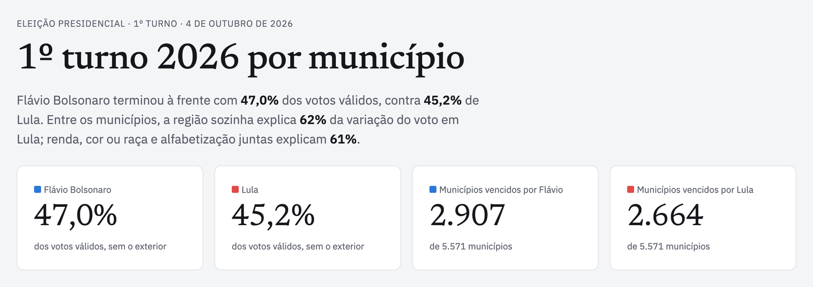
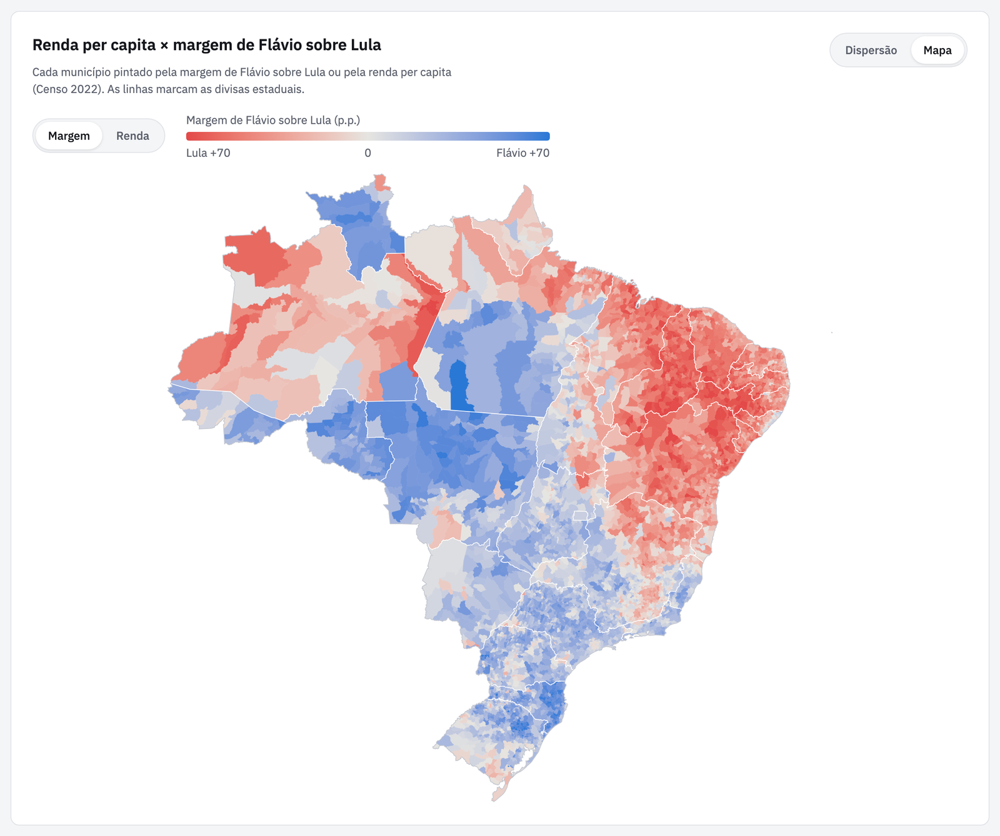
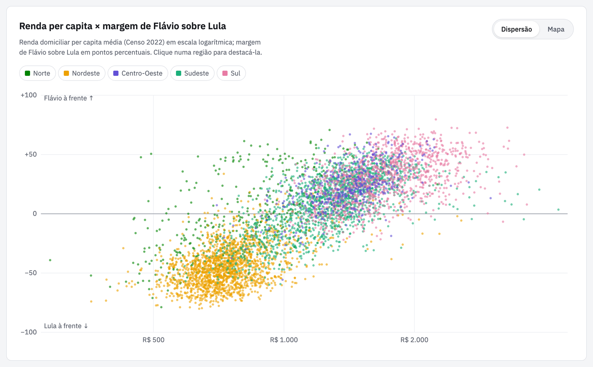
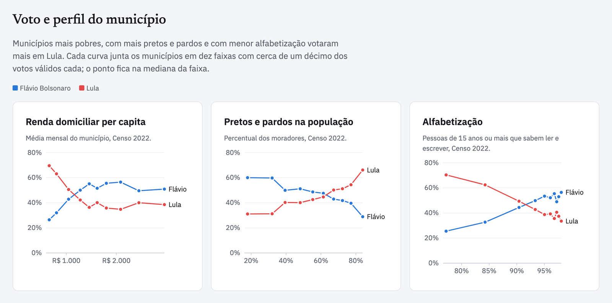

# Eleições 2026: análise municipal e apuração ao vivo

O resultado do 1º turno da eleição presidencial de 2026 (TSE), cruzado com renda, cor ou raça e alfabetização do Censo 2022 (IBGE), município a município. O projeto tem duas partes: um pipeline em Python que baixa e confere os dados oficiais, e um site estático em Astro + d3 que mostra o que eles dizem.

**Site:** https://eleicoes-2026.caioapolonio.dev


[](https://github.com/caioapolonio/eleicoes-2026/actions/workflows/ci.yml)



## O que o site mostra

- **Onde cada um venceu**: votos por região e margem de Flávio sobre Lula em cada estado.
- **Voto e perfil do município**: o voto de cada candidato ao longo de dez faixas de renda, de cor ou raça e de alfabetização.
- **Dentro de cada região**: correlações no país todo e dentro de cada uma das cinco regiões.
- **Município a município**: renda × margem nos 5.570 municípios, em duas visões. A **dispersão** usa escala logarítmica e permite destacar uma região. O **mapa** pinta cada município pela margem ou pela renda. Um link terminado em `#mapa` já abre o mapa.
- **Quanto cada fator explica**: o R² de regressões com região, renda, cor ou raça e alfabetização.
- **2º turno ao vivo**: mapa interativo por estado, resultados nacionais com exterior incluído, 186 localidades do exterior com busca, consulta por município e zona eleitoral, disputas de governador, participação e todos os tipos de votos. Os dados vêm diretamente dos JSONs de divulgação do TSE, com atualização automática, sem depender de republicar o site.

|                              Mapa                               |                                     Dispersão                                     |
| :-------------------------------------------------------------: | :-------------------------------------------------------------------------------: |
|  |  |



## Apuração do segundo turno

A rota `/segundo-turno/` consulta a configuração oficial `ele-c.json` (EA11) para descobrir o pleito e as eleições de segundo turno de 2026. Na consulta de 25/10/2026, foram encontrados o pleito **3221**, a eleição presidencial **6258** e a eleição estadual **6260**, com disputas de governador em AC, AM, DF, ES, RN e TO. Os códigos não são adivinhados nem reutilizados do primeiro turno.

- **EA20**: total nacional, exterior (ZZ), cada UF, municípios/localidades do exterior e zonas eleitorais. O painel apresenta candidaturas, partido/coligação, vices, votos, percentuais, eleito informado pelo TSE, seções, eleitorado, comparecimento, abstenção e categorias de votos, com o JSON completo para consulta e download.
- **O que mudou desde o 1º turno**: dois rankings de barras, “Onde Lula cresceu” e “Onde Flávio cresceu”, com os sete maiores avanços, cores dos candidatos e expansão dos demais estados. Um clique na UF abre seus detalhes no mapa. A base é o percentual parcial de cada candidato no estado no segundo turno menos seu percentual final no primeiro, em pontos percentuais, considerando todos os votos válidos de cada turno. Não é um cruzamento das mesmas urnas. As listas e os valores atualizam com a apuração, preservando a lista expandida. Estados sem votos divulgados não recebem variação. Os 54 percentuais estáticos de `data/analysis/ufs.json` foram conferidos contra os EA20 estaduais da eleição 6257 em 25/10/2026.
- **EA12**: municípios e localidades, códigos IBGE/TSE e zonas. O exterior é apresentado pelas localidades que o TSE fornece; não há agrupamento inventado por país.
- **EA15**: acompanha a publicação das localidades estrangeiras e atualiza resultados que mudaram. Os horários do acompanhamento e do resultado são comparados antes de considerar a atualização concluída, pois os arquivos podem chegar à CDN em momentos diferentes.
- **EA16/EA18**: consulta sob demanda das seções de uma zona, das agregações e dos arquivos de urna (BU, RDV e logs), conforme o TSE os disponibilizar. O auxiliar só é solicitado quando o cadastro sinaliza sua publicação, evitando consultar arquivos inexistentes.
- **EA14** e os demais arquivos de configuração/acompanhamento ficam acessíveis nas fontes. A malha do IBGE já incluída no projeto é agrupada por UF, sem serviço externo de mapas.

A consulta roda no navegador, com CORS do TSE, e mantém o deploy estático em nginx. Cada ciclo termina e aguarda 30 segundos até a próxima consulta; o carregamento inicial das localidades pode levar mais tempo. Abas ocultas suspendem novos ciclos. O cliente limita o início das requisições a uma a cada 150 ms, agrupa consultas iguais em andamento, revalida o cache HTTP, aplica timeout de 15 segundos e espera cinco minutos antes de repetir um 404. Um 403/429 pausa o cliente por mais de dez minutos, evitando renovar um bloqueio. Uma falha mantém o último resultado recebido, com aviso e horário, sem substituir os dados por zeros.

O TSE informa o início da divulgação às **17h de Brasília de 25/10/2026**. Antes disso, arquivos de preparação podem mostrar zero votos. `dv=n` bloqueia a apresentação dos votos; ausência de dados aparece como “—”. Ter 100% das seções totalizadas não significa totalização final nem autoriza indicar um eleito. O total nacional **já inclui o exterior**: o agregado ZZ não é somado novamente. A metodologia do primeiro turno continua específica daquela análise e não se aplica ao painel ao vivo.

Referência: [documentação técnica oficial do TSE](https://www.tse.jus.br/eleicoes/informacoes-tecnicas-sobre-a-divulgacao-de-resultados).

### Verificação

```bash
bun test
bunx prettier --check .
bunx astro check
bun run build
```

Os testes usam um arquivo oficial de preparação de 24/10/2026 como fixture e cobrem identificação da eleição, códigos com zeros à esquerda, resultados zerados/empatados, divulgação suspensa, dados simulados ou de outro turno, chamadas concorrentes e tratamento dos limites de acesso. As consultas reais e os estados de falha também são verificados no navegador durante o desenvolvimento.

## O que os dados mostram

1. **A região é o fator mais forte.**
   - Sozinha, ela explica 62% da variação do voto em Lula entre os municípios (55% no caso de Flávio).
   - Renda, cor ou raça e alfabetização juntas explicam quase o mesmo: 61% para Lula e 53% para Flávio. Com a região junto, chega a 72% e 64%.
   - Lula teve 63,8% no Nordeste e venceu em 1.764 dos 1.794 municípios da região. Flávio teve 60,1% no Sul, 56,5% no Centro-Oeste e 51,4% no Sudeste.
   - O Norte ficou dividido: Flávio teve mais votos (49,2% a 44,7%), mas Lula venceu em mais municípios (246 de 450).
2. **Boa parte do peso da renda é diferença entre regiões.**
   - No país todo, a correlação da renda com o voto em Lula é de −0,63.
   - Dentro do Sul, do Sudeste e do Centro-Oeste, ela fica entre −0,12 e +0,03. No Norte e no Nordeste continua forte, perto de −0,65.
   - Com a mesma renda (de R$ 800 a R$ 1.100 per capita), a margem mediana de Flávio é de −39 pontos no Nordeste, +8 no Sul e +5 no Centro-Oeste.
3. **A relação com cor ou raça aparece em todas as regiões.** A correlação da proporção de pretos e pardos com o voto em Lula é de +0,64 no país e fica entre +0,20 e +0,48 dentro das regiões.
4. **A alfabetização tem a maior correlação nacional** (−0,73 com o voto em Lula), mas dentro das regiões só continua forte no Nordeste (−0,62).

Estas são relações entre municípios, não entre eleitores: não dizem como cada pessoa votou.

## Rodando localmente

Para rodar o site, você precisa de [Bun](https://bun.sh) e Node 22 ou mais novo. Para refazer os dados, também do [uv](https://docs.astral.sh/uv/), que instala o Python 3.13.

```bash
bun install
bun run dev
```

O site abre em `http://localhost:4321`. Os dados já processados estão no repositório, então não é preciso baixar nada para rodar o site.

Para refazer tudo a partir das fontes oficiais:

```bash
bun run data
```

O comando baixa os arquivos do TSE e do IBGE (cerca de 30 MB, guardados em `data/raw/`), confere as somas com o total oficial do TSE e gera de novo as tabelas e os arquivos do site. Para gerar o site estático em `dist/`, que pode ser publicado em qualquer hospedagem:

```bash
bun run build
```

## Deploy e CI/CD

A hospedagem estática com Docker e nginx é adequada para este projeto: os votos do segundo turno são consultados pelo navegador e não precisam de um novo build para se atualizar. O pipeline Python refaz a análise do primeiro turno e não roda durante a apuração ao vivo.

- **Validação compartilhada**: `bun run verify` confere formatação, executa os testes unitários, verifica tipos e gera o site. O mesmo comando roda no GitHub Actions e no Dockerfile, para que o build de produção também rejeite falhas de testes.
- **Versões**: Node 24 no CI e no build Docker. Bun 1.3.14 em `package.json#packageManager` e na imagem usada pelo Dockerfile; o setup do CI lê a versão do `packageManager`. O lockfile é obrigatório e instalado com `--frozen-lockfile`.
- **CI** ([`.github/workflows/ci.yml`](.github/workflows/ci.yml)): roda em PRs, pushes na `main` e manualmente. Limita permissões do token à leitura, impõe timeouts e cancela execuções antigas da mesma referência. Os jobs de site e sintaxe Python rodam antes do job de imagem.
- **Imagem de produção**: o CI constrói a imagem Docker e sobe o nginx real. O script `scripts/check-deployment.mjs` verifica as duas páginas, os bundles, os dados do mapa, cache dos arquivos com hash e o retorno 404. Depois, os testes Playwright exercitam o contêiner em desktop e celular, com respostas do TSE simuladas; o CI não depende da disponibilidade do TSE ou do horário da eleição. Em caso de falha, salva traces, capturas de tela e logs do contêiner.
- **CD/Coolify**: a configuração histórica do projeto informa deploy automático da `main` pelo GitHub App do Coolify. Essa configuração fica fora do repositório; não há workflow de publicação nem evidência de deploy nos endpoints de deployments/status do GitHub consultados. Um build inválido falha no Dockerfile, mas isso não comprova que o Coolify espere o CI completo ou os testes de navegador antes de promover uma versão.
- **Proteção da `main`**: na revisão de 25/10/2026, a branch não estava protegida e não exigia checks. Para que o CI seja uma condição obrigatória de publicação, configure checks obrigatórios na branch e confirme no Coolify que a promoção aguarda o workflow correspondente ao commit. Essas configurações remotas não foram alteradas nesta revisão.
- **Servidor**: nginx serve o site com gzip e cache longo para os arquivos com hash. Dados estáticos em `/data/` podem ficar em cache por uma hora; os resultados ao vivo são buscados diretamente no TSE, fora desse cache. Arquivos `.env` e relatórios locais de testes ficam fora do contexto Docker.

### Testes de navegador e do contêiner

```bash
bun install --frozen-lockfile
bun run verify
bunx playwright install chromium
bun run test:e2e
```

Os testes locais usam o build em `dist/` e uma instância isolada do Astro preview. Para usar o Chrome já instalado, execute `PLAYWRIGHT_CHANNEL=chrome bun run test:e2e`.

Para reproduzir a validação de produção do CI, com Docker em execução:

```bash
docker build -t eleicoes-2026:ci .
docker run -d --name eleicoes-ci -p 127.0.0.1:8080:80 eleicoes-2026:ci
node scripts/check-deployment.mjs http://127.0.0.1:8080
E2E_BASE_URL=http://127.0.0.1:8080 bun run test:e2e
docker rm -f eleicoes-ci
```

### Exterior antes da totalização

Os boletins de urna são documentos de cada seção, emitidos após o encerramento local. Podem circular antes do início da divulgação nacional. Já os JSONs EA20 do painel são a totalização publicada pelo TSE, prevista a partir das 17h de Brasília, inclusive para o exterior. Somar boletins antecipadamente seria outro fluxo, que precisaria controlar a cobertura, as seções agregadas e eventuais reenvios; esse cálculo não é misturado com o total oficial do painel.

Na consulta desta revisão, os arquivos EA20 de Tóquio, Hamamatsu e do exterior ainda tinham zero votos e andamento não iniciado, com geração em 24/10/2026. O cadastro EA16 do exterior também não sinalizava auxiliares publicados. Assim que os JSONs oficiais forem atualizados, o painel busca os novos valores automaticamente. O site Resultados do TSE consome os mesmos arquivos públicos; não é necessário acompanhar manualmente suas páginas.

Referências: [explicação do TSE sobre totalização e boletins](https://www.tse.jus.br/comunicacao/noticias/2026/Outubro/saiba-como-acompanhar-a-totalizacao-dos-votos-apos-as-17h) e [documentação técnica](https://www.tse.jus.br/eleicoes/informacoes-tecnicas-sobre-a-divulgacao-de-resultados).

## Fontes dos dados

| Fonte                                                                                                                                                | O que vem dela                                                                                        |
| ---------------------------------------------------------------------------------------------------------------------------------------------------- | ----------------------------------------------------------------------------------------------------- |
| [TSE · Dados Abertos, Resultados 2026](https://dadosabertos.tse.jus.br/dataset/resultados-2026)                                                      | Votação por partido por município e zona; detalhe da apuração (aptos, comparecimento, brancos, nulos) |
| [TSE · Divulgação de resultados](https://resultados.tse.jus.br/)                                                                                     | Total nacional oficial, usado para conferir as somas, e a tabela que liga o código TSE ao código IBGE |
| [IBGE · Censo 2022, tabela 10295](https://sidra.ibge.gov.br/tabela/10295)                                                                            | Rendimento domiciliar per capita médio e mediano                                                      |
| [IBGE · Censo 2022, tabela 9605](https://sidra.ibge.gov.br/tabela/9605)                                                                              | População por cor ou raça                                                                             |
| [IBGE · Censo 2022, tabela 9543](https://sidra.ibge.gov.br/tabela/9543)                                                                              | Taxa de alfabetização de 15 anos ou mais                                                              |
| [IBGE · Estimativas de população (6579)](https://sidra.ibge.gov.br/tabela/6579) e [PIB dos Municípios (5938)](https://sidra.ibge.gov.br/tabela/5938) | População estimada de 2026 e PIB de 2023 (no CSV, não usados no site)                                 |
| [IBGE · API de malhas](https://servicodados.ibge.gov.br/api/docs/malhas?versao=3)                                                                    | Malha municipal do mapa                                                                               |
| [IBGE · API de localidades](https://servicodados.ibge.gov.br/api/docs/localidades)                                                                   | Região, região intermediária e região imediata de cada município                                      |

Os arquivos do TSE usados aqui foram gerados em 18/10/2026.

## Como os dados são montados

1. **[`build_dataset.py`](build_dataset.py)**
   - Baixa os arquivos do TSE e as tabelas do IBGE.
   - Soma as zonas eleitorais de cada município e liga o código do TSE ao do IBGE.
   - Compara os totais com o resultado oficial e para com erro se algum voto não bater.
   - Gera [`data/municipios_presidente_1t_2026.csv`](data/municipios_presidente_1t_2026.csv): 5.571 municípios × 52 colunas.
2. **[`analyze.py`](analyze.py)**: calcula as faixas, as correlações e as regressões, todas ponderadas por votos válidos, e salva o resultado em [`data/analysis/`](data/analysis).
3. **[`scripts/prepare-site-data.ts`](scripts/prepare-site-data.ts)**: copia a tabela municipal e baixa a malha do IBGE para `public/data/`.

### Detalhes que poupam tempo

- O TSE usa um código de município próprio. A tabela de municípios da divulgação (`oficial/ele2026/6257/config/mun-e006257-cm.json`) traz o código TSE (`cd`) e o código IBGE (`cdi`) lado a lado. Os 5.571 casam, mas 13 nomes são escritos de forma diferente nas duas bases. Por isso, nunca cruze pelo nome.
- Em 2026, os arquivos `dados-simplificados/...-r.json` da divulgação dão 404. Os resultados estão em `dados/{uf}/...-u.json`.
- Para presidente, o número do candidato é o do partido. Assim, o arquivo de votação por partido (24 MB) dá os votos de cada candidato sem precisar do arquivo por candidato (456 MB).
- A API de agregados do IBGE às vezes responde com o corpo em gzip sem avisar no cabeçalho `Content-Encoding`.

## Estrutura

```
├── build_dataset.py        # TSE + IBGE → CSV por município, com conferência dos totais
├── analyze.py              # faixas, correlações e regressões ponderadas
├── Dockerfile, nginx.conf  # imagem de produção (build + nginx)
├── .github/workflows/      # CI
├── data/
│   ├── municipios_presidente_1t_2026.csv
│   └── analysis/           # tabelas que o site lê
├── public/data/            # tabela municipal e malha do mapa, servidas ao navegador
├── scripts/prepare-site-data.ts
└── src/
    ├── layouts/Base.astro  # cabeçalho com as abas dos turnos e rodapé de fontes
    ├── pages/              # index.astro (1º turno) e segundo-turno.astro
    ├── components/         # tabela de correlações, card de municípios, rodapé de fontes
    ├── charts/             # gráficos em d3: barras, faixas, dispersão, mapa
    ├── lib/                # dados tipados, formatação pt-BR, utilitários de gráfico
    └── styles/global.css   # tokens de cor e tipografia, modo claro e escuro
```

## Método e limites

- Cada município pesa pelo número de votos válidos nas faixas, nas correlações e nas regressões. A renda entra em escala logarítmica.
- As faixas juntam municípios ordenados por cada variável em dez grupos, cada um com cerca de um décimo dos votos válidos.
- Os votos do exterior ficam de fora. Por isso, os percentuais nacionais diferem do oficial na segunda casa decimal (47,04% e não 47,03% para Flávio).
- Boa Esperança do Norte (MT) foi criado depois do Censo 2022. Ele tem votos e população estimada, mas fica fora das análises de perfil e do mapa.
- O perfil dos municípios é de 2022 e o voto é de 2026.
